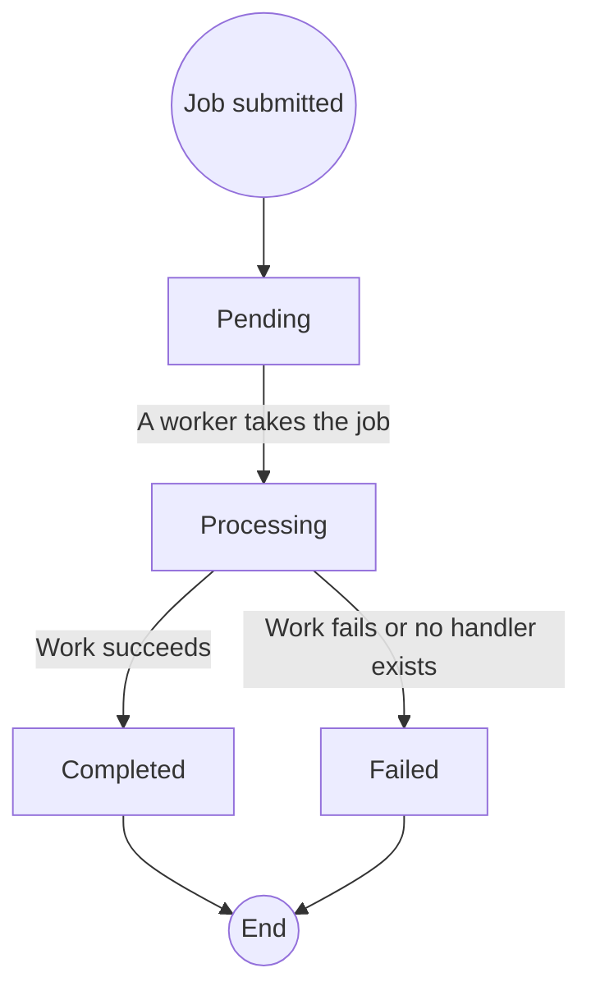
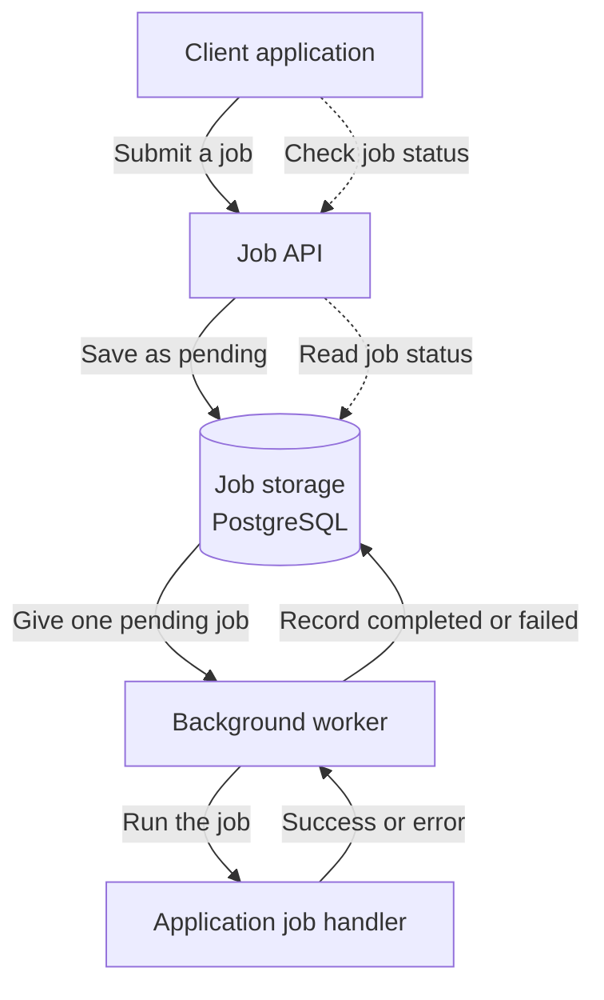

# Dispatchr Architecture

## Purpose

Dispatchr is a distributed job queue with PostgreSQL as its initial and default backend. Clients submit background work through an HTTP API; workers claim and execute that work outside the request path.

The initial goal is a durable, single-worker queue. The architecture must then support multiple independent workers without allowing them to claim the same job concurrently.

Dispatchr's core is storage-backend agnostic. PostgreSQL is the first implementation because it provides durable storage, transactional business-data writes, safe claims, and status queries in one system.

## Initial architecture

```text
                CLIENT
                   |
                   v
               HTTP API
                   |
                   v
              POSTGRESQL
                   ^
                   |
          +--------+--------+
          |        |        |
          v        v        v
        Worker 1 Worker 2 Worker 3
```

The API and a worker may initially run in the same executable, but they have separate responsibilities and can later scale independently.

## Storage adapters

The core queue depends on a storage contract rather than PostgreSQL-specific types or SQL. The contract includes durable enqueueing, status lookup, atomic claiming, completion/failure recording, and idempotency support.

```text
Dispatchr core -> Store contract -> PostgreSQL adapter (default)
                                -> Redis adapter      (future)
                                -> MySQL/Mongo adapter (future)
```

Every adapter must preserve Dispatchr's observable guarantees. Backend-specific optimisations, such as Redis consumer groups or PostgreSQL row locking, remain inside that adapter.

## Components

| Component | Responsibility |
| --- | --- |
| HTTP API | Validates submissions, persists jobs, and exposes job status. |
| Storage adapter | Stores job records durably and coordinates worker claims. PostgreSQL is the default adapter. |
| Worker | Claims eligible jobs, invokes handlers, and records outcomes. |
| Handler registry | Maps a job type, such as `send_email`, to Go code. |

## Durable acceptance

The API inserts a job through the configured storage adapter and commits it before returning a job ID. A successful submission response means the job is durably recorded; it does not mean the work has completed.

```text
POST /jobs -> validate -> insert job -> commit -> return job ID
```

## Current job lifecycle

This diagram shows only the behaviour implemented in the current version.



- `pending`: accepted and eligible for a worker.
- `processing`: atomically claimed by one worker.
- `completed`: the handler succeeded and completion was persisted.
- `failed`: the handler failed, or no handler was registered for its type.

Future phases add retry, delayed, priority, and dead-letter transitions.

## Worker discovery and claiming

Workers use a pull model: each worker asks the configured storage adapter for one eligible job. PostgreSQL implements this with a row lock and changes the selected job to `processing` in the same short transaction.

```sql
SELECT id
FROM jobs
WHERE status = 'pending'
  AND attempts < max_attempts
FOR UPDATE SKIP LOCKED
LIMIT 1;
```

`FOR UPDATE SKIP LOCKED` lets concurrent workers skip jobs already being claimed by another worker. The worker commits its claim before executing the handler, so slow external work never holds a database transaction open.

## Current delivery behaviour

Dispatchr already guarantees durable acceptance: once `POST /jobs` succeeds,
the job is stored in PostgreSQL and survives an API restart.

It does **not yet** provide full at-least-once delivery. If a worker crashes
after claiming a job, the job remains `processing` because lease expiry and
recovery are not implemented yet.

The target model is at-least-once delivery: an expired lease will make an
abandoned job eligible again. That prevents silent loss, but means a handler
may run more than once after a crash.

## Idempotent handlers

Handlers must make repeated execution safe. Each business operation uses a stable idempotency key, for example:

```text
invoice:order_123
```

The configured storage adapter enforces uniqueness for that key. A retry retrieves the existing invoice rather than creating a second one. When an external provider supports it, use the same stable key with that provider as well.

```text
atomic claim prevents concurrent duplicate work
idempotency prevents retry duplicate effects
```

## Crash recovery and future phases

The initial version records a claimed job as `processing`. A worker crash can leave that job in this state.

Later phases add a worker ID, lease expiry, and heartbeats. When a lease expires, another worker can reclaim the abandoned job. Retries will use exponential backoff and eventually move permanently failing jobs to a dead-letter state.

## API contract

```text
POST /jobs       submit durable background work
GET  /jobs/{id}  retrieve status, attempts, result, or error
```

The API returns job status from the configured storage adapter; clients do not infer completion from successful submission.

## Component architecture


